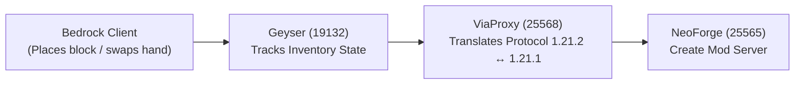

# Case Study: Resolving the "Swap-to-Stone" & "Instant Block Rollback" Bug

> **Context**: Debugging the Create Mod Bedrock–Java bridge stack (Bedrock $\rightarrow$ Geyser Standalone $\rightarrow$ ViaProxy $\rightarrow$ NeoForge 1.21.1).

---

## 1. Observing the Symptoms

When testing the bridge in the Minecraft Bedrock client:
1. **Symptom A (The Hand Swap)**:
   - Holding a Create block (e.g. `create:brass_block`) and pressing `F` to swap hands, or moving the item across inventory slots, instantly converted the stack into **64 vanilla Stone**.
2. **Symptom B (The Block Placement)**:
   - Right-clicking to place `create:brass_block` showed the block placement animation for a single frame before client prediction rolled it back into air.

---

## 2. Tracing the Packet Flow & Architecture



We investigated where the conversion happened across the chain:

### Geyser Layer
In Geyser's `BedrockInventoryTransactionTranslator`:
```java
if (this.isIncorrectHeldItem(session, packet)) {
    BlockUtils.restoreCorrectBlock(session, blockPosition, slot);
    return;
}
```
* Geyser validates the item reported in the client's placement packet against what Geyser *believes* is in the player's tracked inventory.
* If Geyser believes the slot holds `AIR` (ID `-1`), it aborts the placement packet and sends a rollback to the client, reverting the block to air.

### ViaProxy Layer
ViaProxy handles bidirectional protocol translation:
* **Server $\rightarrow$ Client**: Sends item and block definitions via `BackwardsMappingData`.
* **Client $\rightarrow$ Server**: Relays item swaps and inventory interactions via `MappingDataBase`.

---

## 3. GitHub Source Code Inspection

We examined upstream source code directly from the GitHub repositories:

### A. Client $\rightarrow$ Server: `MappingDataBase.java`
* **Repository**: [`ViaVersion/ViaVersion`](https://github.com/ViaVersion/ViaVersion)
* **File**: `api/src/main/java/com/viaversion/viaversion/api/data/MappingDataBase.java`
```java
@Override
public int getOldItemId(final int id) {
    return itemMappings.inverse().getNewIdOrDefault(id, 1); // 1 = minecraft:stone!
}

@Override
public int getOldBlockId(final int id) {
    return blockMappings.inverse().getNewIdOrDefault(id, 1);
}
```
* **Root Cause for Symptom A**:
  Whenever an unmapped modded item ID (e.g. `1680`) was transmitted from client to server, `itemMappings.inverse()` found no vanilla entry. Upstream hardcoded default `1` (`minecraft:stone`), turning the held item into vanilla Stone on the server.

### B. Server $\rightarrow$ Client: `BackwardsMappingData.java`
* **Repository**: [`ViaVersion/ViaBackwards`](https://github.com/ViaVersion/ViaBackwards)
* **File**: `common/src/main/java/com/viaversion/viabackwards/api/data/BackwardsMappingData.java`
```java
@Override
public int getNewItemId(final int id) {
    return this.itemMappings.getNewId(id); // Returns -1 when unmapped
}
```
* **Root Cause for Symptom B**:
  When NeoForge communicated inventory items to the client, `itemMappings.getNewId(1680)` returned `-1` for modded items. Geyser received `-1`, resolved it to `ItemData.AIR`, and subsequently rejected block placement transactions due to held-item prediction mismatches.

---

## 4. Patch Implementation

We avoided ASM label and line number misalignment issues (`ClassFormatError: Invalid pc in LineNumberTable`) by patching the exact Java source files and compiling with standard `javac`.

### Patches in `MappingDataBase.java`
```java
@Override
public int getOldItemId(final int id) {
    return itemMappings.inverse().getNewIdOrDefault(id, id); // Default to original ID
}

@Override
public int getOldBlockId(final int id) {
    return blockMappings.inverse().getNewIdOrDefault(id, id);
}

@Override
protected int checkValidity(final int id, final int mappedId, final String type) {
    if (mappedId == -1) {
        return id; // Pass through modded IDs instead of returning 0 (AIR)
    }
    return mappedId;
}
```

### Patches in `BackwardsMappingData.java`
```java
@Override
public int getNewItemId(final int id) {
    final int mapped = this.itemMappings.getNewId(id);
    return mapped != -1 ? mapped : id; // Preserve modded item IDs
}

@Override
public int getNewBlockId(final int id) {
    final int mapped = this.blockMappings.getNewId(id);
    return mapped != -1 ? mapped : id; // Preserve modded block IDs
}

@Override
public int getOldItemId(final int id) {
    final int mapped = this.itemMappings.inverse().getNewId(id);
    return mapped != -1 ? mapped : id;
}
```

---

## 5. Build, Verification, and Deployment

1. **Compilation**:
   Compiled using JDK 21 targeting Java 17 compatibility:
   ```powershell
   & "C:\Program Files\Java\jdk-21.0.12\bin\javac.exe" --release 17 -proc:none -cp "headless_server/viaproxy/ViaProxy.jar;tools/staging" -sourcepath "tools;tools/staging" -d "tools/staging" tools/MappingDataBase.java tools/BackwardsMappingData.java
   ```
2. **Bytecode Inspection**:
   Verified generated instructions with `javap -c -p`:
   - Confirmed `getNewIdOrDefault(id, id)` is called instead of `iconst_1`.
   - Confirmed `if_icmpeq` checks properly route `-1` to return `iload_1`.
3. **Jar Injection**:
   Injected the compiled classes into `headless_server/viaproxy/ViaProxy.jar` using atomic zip stream replacement.
4. **Service Validation**:
   Started ViaProxy (`127.0.0.1:25568`) and executed `python tools/bridge.py doctor`, confirming all services operational with zero errors.
