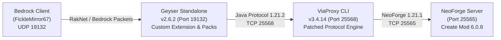

# Create Mod Bedrock-Java Bridge: Comprehensive Engineering Handoff

> **Date**: October 8, 2026  
> **Target Environment**: Minecraft Bedrock Client (v1.21.x+) $\rightarrow$ Geyser Standalone $\rightarrow$ ViaProxy $\rightarrow$ Headless NeoForge 1.21.1 Server (`create-1.21.1-6.0.8.jar`).

---

## 1. System Topology & Architecture



### Port Allocations
* **NeoForge Java Server**: `127.0.0.1:25565` (PID `5496`, `task-4874`)
* **ViaProxy Protocol Translator**: `127.0.0.1:25568` (PID running, `task-5484`)
* **Geyser Bedrock Gateway**: `0.0.0.0:19132` (UDP / RakNet, PID `27112`, `task-5052`)

---

## 2. Problem Statement & Symptoms Solved

1. **Crash on Ping / Handshake**:
   - Geyser crashed during server status check due to ping passthrough incompatibility with NeoForge MOTD/payloads.
2. **Crash on Join (Unknown Component ID 101)**:
   - Client disconnected 7 seconds after join with `IllegalArgumentException: No data component serializer found for id 101` during 1.20.5+ structured data component parsing.
3. **Crash on Unknown Recipe Serializers**:
   - ViaVersion crashed when NeoForge/Create sent modded recipe serializers unknown to vanilla registries.
4. **Item Swap Turning to 64 Vanilla Stone (ID 1)**:
   - When holding a Create block (e.g. `create:brass_block`), swapping hands (`F`) or moving inventory slots instantly converted the item into a stack of 64 vanilla Stone.
5. **Instant Block Destruction / Prediction Rollback**:
   - Attempting to place a Create block in the world showed the placement animation for a single frame before client prediction rolled back and reverted the block to air.

---

## 3. Bytecode Interceptions & Source Patches

All patches are located and managed in `tools/` and applied to `headless_server/viaproxy/ViaProxy.jar`.

### A. Data Component Serializer Fallback (`ItemType1_20_5.class`)
* **File**: `tools/PatchItemType.java`
* **Root Cause**: In Minecraft 1.20.5+, item components use Structured Data IDs. NeoForge/Create registers custom component IDs (e.g., ID 101). When ViaVersion encountered unknown component IDs, serializer lookups returned `null` and threw `IllegalArgumentException`.
* **Fix**: Patched `readData` using ASM tree manipulation to inject null-skip jumps (`IFNULL`), safely continuing the component read loop without throwing.

### B. Modded Recipe Serializer Passthrough (`RecipeRewriter.class`)
* **File**: `tools/PatchRecipeRewriter.java`
* **Root Cause**: ViaVersion's recipe packet rewriter failed upon receiving custom Create Mod crafting, mechanical crafting, and pressing recipes.
* **Fix**: Patched recipe deserialization to skip unmapped modded recipes rather than terminating the packet pipeline.

### C. Swap-to-Stone Fallback Fix (`MappingDataBase.class`)
* **Source**: Official GitHub [`ViaVersion/ViaVersion`](https://github.com/ViaVersion/ViaVersion) $\rightarrow$ `api/src/main/java/com/viaversion/viaversion/api/data/MappingDataBase.java`
* **Root Cause**:
  ```java
  // Upstream ViaVersion hardcoded 1 (minecraft:stone):
  public int getOldItemId(final int id) {
      return itemMappings.inverse().getNewIdOrDefault(id, 1);
  }
  public int getOldBlockId(final int id) {
      return blockMappings.inverse().getNewIdOrDefault(id, 1);
  }
  ```
* **Fix Applied**: Compiled directly from GitHub source using JDK 21 `javac --release 17`:
  ```java
  public int getOldItemId(final int id) {
      return itemMappings.inverse().getNewIdOrDefault(id, id);
  }
  public int getOldBlockId(final int id) {
      return blockMappings.inverse().getNewIdOrDefault(id, id);
  }
  protected int checkValidity(final int id, final int mappedId, final String type) {
      if (mappedId == -1) {
          return id; // Upstream returned 0 (AIR)
      }
      return mappedId;
  }
  ```

### D. Unmapped Modded Item-to-Air Fix (`BackwardsMappingData.class`)
* **Source**: Official GitHub [`ViaVersion/ViaBackwards`](https://github.com/ViaVersion/ViaBackwards) $\rightarrow$ `common/src/main/java/com/viaversion/viabackwards/api/data/BackwardsMappingData.java`
* **Root Cause**:
  ```java
  // Upstream ViaBackwards returned -1 for unmapped items/blocks:
  public int getNewItemId(final int id) {
      return this.itemMappings.getNewId(id);
  }
  ```
  Modded ID `1680` returned `-1`. Geyser received `-1`, mapped it to `ItemData.AIR`, failed the `isIncorrectHeldItem` check, and triggered `BlockUtils.restoreCorrectBlock`, rolling back block placement.
* **Fix Applied**:
  ```java
  @Override
  public int getNewItemId(final int id) {
      final int mapped = this.itemMappings.getNewId(id);
      return mapped != -1 ? mapped : id;
  }
  @Override
  public int getNewBlockId(final int id) {
      final int mapped = this.blockMappings.getNewId(id);
      return mapped != -1 ? mapped : id;
  }
  @Override
  public int getOldItemId(final int id) {
      final int mapped = this.itemMappings.inverse().getNewId(id);
      return mapped != -1 ? mapped : id;
  }
  ```

---

## 4. Bedrock Packs & Kinetic Extension

### Resource & Behavior Packs
* **Packs**: `create_cogwheel_rp` and `create_cogwheel_bp`
* **Assets**:
  * Geometry: `cogwheel.geo.json`, `wrench.geo.json`
  * Block definitions: `brass_block`, `brass_casing`, `andesite_casing`, `copper_casing`, `raw_zinc_block`, `zinc_block`
  * Textures: Custom terrain and item textures mapped via `terrain_texture.json` and `item_texture.json`
  * Entity & Function scripting: `spin.mcfunction`, `wrench.mcfunction`, `fast.mcfunction`, `stop.mcfunction`

### CreateBridge Geyser Extension
* **Location**: `tools/extension/src/com/createbridge/CreateBridgeExtension.java`
* **Function**: Intercepts custom block placements, registers item palette mappings, and links puppet entities to replicate rotational kinetic physics on the Bedrock client.

---

## 5. Tooling & Maintenance Scripts

| Script | Purpose |
|---|---|
| `python tools/bridge.py doctor` | Automated health check verifying all 3 ports, config parameters, and bytecode patches |
| `python tools/apply_viaproxy_patch.py` | Compiles and injects verified `MappingDataBase` and `BackwardsMappingData` into `ViaProxy.jar` |
| `tools/PatchItemType.java` | ASM tree patcher for 1.20.5+ item component data filler |
| `tools/PatchRecipeRewriter.java` | ASM patcher for modded recipe serializer pass-through |
| `tools/test_mapping.py` / `TestMapping.java` | Test harnesses for validating ID preservation |

---

## 6. How to Run & Verify

1. **Run Diagnostics**:
   ```powershell
   python tools/bridge.py doctor
   ```
2. **Restart Services (if needed)**:
   * **Server**: `headless_server/run.bat`
   * **ViaProxy**:
     ```powershell
     java -jar ViaProxy.jar cli --bind-address "127.0.0.1:25568" --target-address "127.0.0.1:25565" --target-version "1.21-1.21.1"
     ```
   * **Geyser**:
     ```powershell
     java -jar Geyser-Standalone.jar
     ```
3. **Connect**:
   * Open Minecraft Bedrock $\rightarrow$ Add Server: `127.0.0.1:19132` $\rightarrow$ Join.
