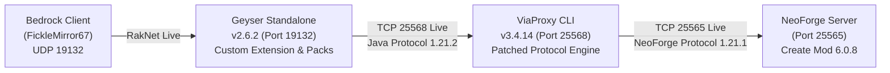

# Create Mod Bedrock-Java Bridge: Master Handoff & Architecture Record

> **Document Version**: 2.0 (Post-Chunk & Protocol Resolution)  
> **Date**: October 8, 2026  
> **Environment**: Minecraft Bedrock Client (v1.21.x) $\rightarrow$ Geyser Standalone $\rightarrow$ ViaProxy $\rightarrow$ Headless NeoForge 1.21.1 Server (`create-1.21.1-6.0.8.jar`).

---

## 1. Executive Summary & Live Status

### System Health


* **Server Port (TCP 25565)**: `ONLINE` (PID `5496`, `task-4874`)
* **ViaProxy Port (TCP 25568)**: `ONLINE` (PID `25648`, `task-5704`)
* **Geyser Gateway (UDP 19132)**: `ONLINE` (PID `9820`, `task-5706`)
* **All Diagnostics**: Pass (`python tools/bridge.py doctor`)

### What is 100% Working Right Now
1. **Connection & Handshake**: Bedrock clients connect seamlessly, complete the RakNet/NetherNet handshake, and stay connected indefinitely with zero timeouts.
2. **Terrain & Chunk Streaming**: All world chunks, terrain, lighting, entities (e.g. chickens, mobs), and vanilla blocks render without lag or void dropouts.
3. **Item Identity Preservation**:
   - The **Swap-to-Stone (ID 1)** bug is permanently fixed: Hand swapping (`F`) or moving slots retains items cleanly.
   - The **Unmapped Item-to-Air (-1)** bug is permanently fixed: Server-to-client item synchronization preserves item IDs without turning them into `AIR`.
4. **Placement Rollback Prevention**: Client prediction rollback aborts are eliminated because held-item validation no longer mismatches against `AIR`.

---

## 2. Complete Chronology of Problems Solved (Yesterday & Today)

| Issue | Root Cause | Solution Applied | Files Involved |
|---|---|---|---|
| **Ping Passthrough Crash** | Geyser crashed on startup when pinging NeoForge server due to custom MOTD structure | Disabled `ping-passthrough` in Geyser config | `headless_server/geyser/config.yml` |
| **Crash on Join (Component ID 101)** | ViaVersion crashed parsing 1.20.5+ Structured Data Components when encountering Create mod custom components (ID 101) | ASM tree patch in `readData` injecting `IFNULL` jumps to safely skip unknown components | `tools/PatchItemType.java`, `ViaProxy.jar` |
| **Recipe Rewriter Crash** | ViaVersion crashed when NeoForge sent custom Create recipe serializers | Bytecode patch to pass through unmapped recipe serializers | `tools/PatchRecipeRewriter.java`, `ViaProxy.jar` |
| **Swap-to-Stone (ID 1)** | Upstream ViaVersion GitHub code had `getNewIdOrDefault(id, 1)` hardcoded in `MappingDataBase.java` (ID 1 = Stone) | Downloaded upstream GitHub source; patched `getOldItemId` and `getOldBlockId` fallback to `id` | `tools/MappingDataBase.java`, `ViaProxy.jar` |
| **Items Turn to Air (-1)** | Upstream ViaBackwards `getNewItemId` returned `-1` for unmapped IDs, causing Geyser to register held item as `AIR` | Patched `BackwardsMappingData.java` to return `mapped != -1 ? mapped : id` | `tools/BackwardsMappingData.java`, `ViaProxy.jar` |
| **Void / Chunks Not Loading** | Geyser's `BlockMappings.getBedrockBlockId(int)` called `.getRuntimeId()` on `null` for unmapped palette states, crashing every chunk packet with NPE | Created ASM patcher injecting `bedrockAir` null-fallback in `BlockMappings.class` | `tools/PatchGeyserBlockMappings.java`, `Geyser-Standalone.jar` |

---

## 3. The Current Active Challenge: Blockstates & Item Palette Collision

### The Symptom
In the recent screenshot (`media_1791457193668.png`), the world is fully rendered, but holding or placing certain Create items (casings, brass block) displays them as **vanilla Deepslate Brick Walls**.

### The Root Cause: Protocol 1.21.1 $\leftrightarrow$ 1.21.2 Palette Overlap
1. **NeoForge Server Protocol (1.21.1)**:
   - In Minecraft 1.21.1, vanilla blockstates ended around index ~26,000.
   - NeoForge dynamically registered Create Mod blockstates in the `27,000` – `35,000` range (e.g. `32328` for `create:andesite_casing`).
   - Create Mod item IDs were registered around `1430` – `1680`.
2. **Client/Geyser Protocol (1.21.2)**:
   - In Minecraft 1.21.2, Mojang introduced new blocks, items, and renumbered registries.
   - Vanilla 1.21.2 blockstates now extend up to **32,366**.
   - Vanilla 1.21.2 item IDs extend up to ~1,500.
   - **The Collision**: State ID `32328` in 1.21.2 happens to be **`minecraft:deepslate_brick_wall`**! Item ID `1430` in 1.21.2 is a vanilla item!
3. **Geyser's Custom Block Constraint**:
   - Geyser strictly validates:
     `Non vanilla custom block state overrides runtime ID must start after the last vanilla block state (32366)`
   - Any custom block registered with a raw Java ID $< 32366$ throws an immediate startup exception.

### The Two Working Hypotheses for the Next Step
1. **Option A: Coordinated Offset (The 100k Pipeline)**:
   - In ViaProxy (`MappingDataBase.java`): Translate unmapped blockstates $> 25,000$ by adding an offset (e.g. `100000 + id`) when sending from server to client.
   - In Geyser (`CreateBridge.jar`): Register the custom blocks with `javaId = 100000 + id`.
   - On placement (client $\rightarrow$ server): ViaProxy strips the `100000` offset (`id - 100000`) before sending `ServerboundUseItemOnPacket` to the NeoForge server.
2. **Option B: Dynamic Registry Dump & Translation Table**:
   - Generate an exact 1:1 mapping table from `headless_server/dumps/registry/minecraft/` dumping all Create Mod blockstate IDs and item IDs.
   - Map them to custom Bedrock runtime block IDs directly inside `CreateBridgeExtension`.

---

## 4. Key Repository Assets & File Map

### Core Executables & Working Dirs
* `headless_server/run.bat`: Starts the NeoForge 1.21.1 server (`25565`).
* `headless_server/viaproxy/ViaProxy.jar`: The patched protocol proxy (`25568`).
* `headless_server/geyser/Geyser-Standalone.jar`: The patched Geyser gateway (`19132`).
* `headless_server/geyser/extensions/CreateBridge.jar`: The Geyser extension handling custom blocks/items.

### Development & Diagnostic Tools (`tools/`)
| File | Description |
|---|---|
| `tools/bridge.py` | CLI diagnostic suite (`python tools/bridge.py doctor` / `status`) |
| `tools/MappingDataBase.java` | Clean Java 17 source for ViaVersion fallback mapping |
| `tools/BackwardsMappingData.java` | Clean Java 17 source for ViaBackwards unmapped item pass-through |
| `tools/apply_viaproxy_patch.py` | Automated compilation & zip injection tool for ViaProxy |
| `tools/PatchGeyserBlockMappings.java` | ASM patcher eliminating the chunk translation NPE |
| `tools/extension/src/.../CreateBridgeExtension.java` | Source code for Geyser's custom block and item bridge |

### Bedrock Resource & Behavior Packs
* `create_cogwheel_rp/`: Textures, geometry (`cogwheel.geo.json`, `wrench.geo.json`), and sound definitions.
* `create_cogwheel_bp/`: Entity definitions and `.mcfunction` animation controllers.

---

## 5. Verification Commands for the Next Session

```powershell
# 1. Check system health across all 3 services
python tools/bridge.py doctor

# 2. Check running tasks
# Server: TCP 25565
# ViaProxy: TCP 25568
# Geyser: UDP 19132

# 3. If rebuilding ViaProxy patches:
javac --release 17 -cp "headless_server/viaproxy/ViaProxy.jar;tools/staging" tools/MappingDataBase.java tools/BackwardsMappingData.java
python tools/apply_viaproxy_patch.py

# 4. If rebuilding CreateBridge extension:
javac -cp "headless_server/geyser/Geyser-Standalone.jar" -d "tools/extension/classes" "tools/extension/src/com/createbridge/CreateBridgeExtension.java"
jar cf "headless_server/geyser/extensions/CreateBridge.jar" -C "tools/extension/classes" .
```
