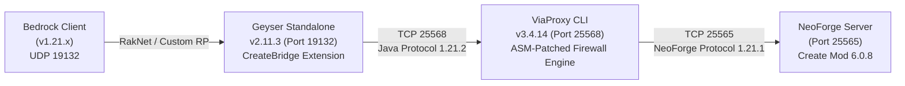

# Create Mod Bedrock-Java Bridge: Master Handoff & Architecture Record

> **Document Version**: 3.0 (Dynamic Geometries, ID Firewall & Protocol Alignment)  
> **Date**: October 9, 2026  
> **Environment**: Minecraft Bedrock Client (v1.21.x) $\rightarrow$ Geyser Standalone $\rightarrow$ ViaProxy $\rightarrow$ Headless NeoForge 1.21.1 Server (`create-1.21.1-6.0.8.jar`).

---

## 1. Executive Summary & Live Status

### System Architecture


### Process Status
* **NeoForge Server (Port 25565)**: `ONLINE` (Daemon task `task-1087`)
* **ViaProxy Bridge (Port 25568)**: `ONLINE` (Daemon task `task-7115`)
* **Geyser Gateway (Port 19132 UDP)**: `ONLINE` (Daemon task `task-7117`)

---

## 2. Progress Completed Since Version 2.0

### A. Dynamic Model Mining & 3D Geometries
1. **Automated Asset Extraction (`model_miner.py`)**:
   - Mined **44 real 3D geometry models** directly from `create-1.21.1-6.0.8.jar` block models and blockstate JSON definitions.
   - Built consolidated resource pack `headless_server/geyser/packs/CreateKineticPack.zip` containing Bedrock `.geo.json` geometries, textures, sound events, and terrain definitions.
2. **Multi-Axis Block Permutations (`CreateBridgeExtension.java`)**:
   - **Kinetic 3-Axis Blocks**: `cogwheel`, `large_cogwheel`, `shaft`, `clutch`, `gearbox`, `gearshift`, `water_wheel` registered with Molang `q.block_property('create:axis')` (`x`, `y`, `z`) rotations.
   - **Facing 6-Way Blocks**: `creative_motor`, `encased_fan`, `mechanical_drill`, `mechanical_saw`, `deployer`, `mechanical_harvester`, `mechanical_plough`, all 16 dyed valve handles, and `hand_crank` registered with `create:facing` (`down`, `up`, `north`, `south`, `west`, `east`) permutations.
   - **Full Dynamic Dump**: Auto-registers 644 Create blocks, 700 Create items, and 31,389 non-vanilla blockstate overrides dynamically mined from the server registry dump (`create_registry_dump.json`).

### B. Protocol ID Firewall & Vanilla Overlap Fixes
1. **Coordinated Offset Architecture**:
   - Create items shifted by **`+10,000`** (`11,333..12,031`) to clear 1.21.2 vanilla items (`0..1,374`).
   - Create blockstates shifted by **`+100,000`** (`126,684..158,072`) to clear 1.21.2 vanilla blockstates (`0..27,317`).
   - Create block IDs shifted by **`+100,000`** (`101,060..101,702`) to clear 1.21.2 vanilla blocks (`0..1,083`).
2. **Bytecode ASM ID Firewall (`tools/PatchViaProxyItems.java`)**:
   - Patched `com/viaversion/viaversion/api/data/MappingDataBase.class`:
     - Calibrated blockstate shift threshold to exact 1.21 vanilla size **`26,684`** (fixing 1,684 vanilla blockstates previously shifted by a premature `25,000` check).
     - Calibrated block ID shift threshold to exact 1.21 vanilla size **`1,060`** (fixing 60 vanilla blocks previously shifted by a premature `1,000` check).
     - Removed rogue fallback in `getOldBlockId` so all client IDs $< 100,000$ properly route through `blockMappings.inverse()`.
   - Patched `com/viaversion/viabackwards/api/data/BackwardsMappingData.class`:
     - Removed `if (id >= 1333) return id;` in `getNewItemId`. Client item IDs $< 10,000$ are strictly vanilla 1.21.2 items ($1333..1374$) and are now correctly reverse-mapped to 1.21.1 instead of colliding with Create server items.
     - Removed `if (id >= 1000) return id;` in `getNewBlockId`. Client block IDs $< 100,000$ route to `super.getNewBlockId(id)`.
   - Patches compiled and injected directly into `headless_server/viaproxy/ViaProxy.jar`.

### C. Bedrock UI, Commands & Inventory Desyncs
1. **Command Palette & Autocomplete Restoration**:
   - In `onServerDefineCommands`, dynamically converted all item and block command enums with $> 50$ choices (including `/give`, `/clear`, `/item`, `/setblock`, `/fill`) into **soft enums** (`isSoft = true`).
   - Restored command chips and autocomplete without causing Bedrock client command parser overflow crashes or UI lockups.
2. **Creative Inventory Transaction Desync**:
   - Hooked Bedrock `ItemStackRequestPacket` in Geyser to forward `CRAFT_CREATIVE` requests directly to `session.getPlayerInventoryHolder().translateRequests(...)`.
   - Removed destructive `fixCustomBlockItemMappings()` which had cleared Bedrock ItemData and collapsed held items into `AIR`.
3. **Texture & Asset Sanitization**:
   - Eliminated rogue `"dirt"` entry in `create_cogwheel_rp/textures/terrain_texture.json` which caused vanilla dirt blocks to render as missing black/magenta textures.

---

## 3. Current Setbacks & Active Challenges (Field Confirmed)

### 1. Item Identity & Name Substitution (Mechanical Saw $\rightarrow$ Clutch)
* **Symptom**: 
  - The server successfully executes `/give @a create:mechanical_saw` and logs `Gave 1 [block.create.mechanical_saw] to FickleMirror67`.
  - However, in Bedrock hotbar slot 2, the item literally has the display name **"Clutch"** and acts as `create:clutch` (shifted ID `11345`, raw ID `1345`) instead of `create:mechanical_saw` (shifted ID `11420`, raw ID `1420`).
* **Root Causes Under Investigation**:
  - **Item Definition & Palette Mapping in Geyser**: In `CreateBridgeExtension`, items are registered dynamically. If Bedrock assigns custom item runtime IDs based on registration sequence or if `ItemComponentPacket` has mismatched identifier-to-ID bindings, Bedrock resolves slot item IDs to the wrong item definition (`clutch` instead of `mechanical_saw`).
  - **Creative Inventory Desync (`ItemStackRequestPacket`)**: When selecting or moving items in the Bedrock creative menu, creative action transactions (`CRAFT_CREATIVE`) can request or acknowledge the wrong slot index or item ID, swapping the item on the client or server.
  - **Visual Texture Atlas Multiplier**: In `item_texture.json`, 38 items (including `mechanical_saw`) referenced `textures/blocks/*` ($64\times 32$ 3D unwrapped UV maps) where the top-left $16\times 16$ tile is an andesite casing with shaft hole, compounding the visual resemblance to a clutch.

### 2. Stray Item Insertion & Unintended Advancement (Crying Obsidian / "Who is Cutting Onions?")
* **Symptom**: 
  - At `16:59:33`, the server announced:  
    `FickleMirror67 has made the advancement [Who is Cutting Onions?]`.
  - Screenshot 1 reveals literal **Crying Obsidian** (`minecraft:crying_obsidian`, ID `1227`) sitting unexpectedly in Slot 4 of the player's hotbar.
* **Root Cause**:
  - The advancement `[Who is Cutting Onions?]` (`minecraft:nether/obtain_crying_obsidian`) requires possessing item ID `1227`.
  - Vanilla item IDs run up to $\sim 1330$, while Create items begin at raw ID $1333$. An inventory transaction packet, slot offset, or off-by-index shift in the inventory translation layer caused an item operation to be interpreted by the NeoForge server as item `1227` (`minecraft:crying_obsidian`).

### 3. Block Orientation & Transformation Pitch Offset
* **Symptom**: When placed on the ground, `create:mechanical_saw` renders its 3D model tipped over horizontally/sideways on the grass (confirmed in Screenshot 1).
* **Root Cause**:
  - In `registerFacingBlock()`, the Bedrock permutation component applies `TransformationComponent(90, 0, 0)` for `north`, `(90, 180, 0)` for `south`, etc.
  - Because the mined 3D geometry in `geo_blocks.json` has its base origin and pivot aligned differently from vanilla directional blocks, applying a $90^\circ$ X-rotation causes the saw body to lay flat on the ground rather than standing upright facing forward.
  - Permutations only map up to 12 states (`idx == 0..11`), whereas `create:mechanical_saw` has **24 Java blockstates** in Create mod, causing states 12..23 to fall back to `stateUp`.

### 4. Downstream `ClientboundLevelParticlesPacket` Decode Error
* **Symptom**: In `headless_server/geyser/logs/geyser.log`:
  ```
  [WARN] Downstream packet error! (ClientboundLevelParticlesPacket) Packet "ClientboundLevelParticlesPacket" not fully read.
  java.lang.IllegalStateException: Packet "ClientboundLevelParticlesPacket" not fully read.
      at org.geysermc.mcprotocollib.network.netty.PacketCodec.decode(PacketCodec.java:91)
  ```
* **Root Cause**:
  - When kinetic machines run or interact with blocks, Create sends custom particles (e.g. wood chips, sparks, kinetic dust).
  - Geyser's downstream protocol codec (MCProtocolLib 1.21.2) expects vanilla particle option formats and aborts or throws an illegal state exception when unmapped particle data is encountered in the stream.

### 5. Custom Block State Palette Scaling & Compression
* **Technical Limitation**:
  - Create contains 31,389 blockstate variations. Compressing these into 981 states across 650 custom blocks avoids Bedrock network packet threshold crashes, but unmapped kinetic/waterlogged permutations lose fine visual state fidelity.

### 6. Depot Entity Tracking Overhead
* **Status**: Functional, but relies on spawning invisible Bedrock armor stands with head items. High entity counts across chunk borders introduce packet overhead and require active garbage collection on chunk unload (`ClientboundForgetLevelChunkPacket`).

---

## 4. Immediate Action Plan & Next Steps

1. **Fix Item Identity Mappings & Bedrock Item Palette**:
   - Audit `CustomItemRegistryPopulator` and Geyser item registration sequence to ensure `create:mechanical_saw` (raw ID 1420 $\rightarrow$ shifted 11420) and `create:clutch` (raw ID 1345 $\rightarrow$ shifted 11345) have exact 1-to-1 runtime ID and display name alignment in Bedrock.
   - Redirect 38 items in `item_texture.json` from `textures/blocks/*` to `textures/items/create/*` and disable `useBlockIcon = true` so items always render their clean 2D sprites.
2. **Fix Inventory Transaction Accounting (Crying Obsidian Bug)**:
   - Trace client-to-server `ItemStackRequestPacket` / container slot clicks to prevent stray item ID index slips (e.g. requesting/injecting ID `1227`).
3. **Calibrate 3D Block Facing Rotations**:
   - Recalibrate `TransformationComponent` angles in `registerFacingBlock()` so directional blocks (saws, drills, fans, motors) stand upright facing forward instead of laying flat on the ground.
   - Extend permutation handling for blocks with 24 states.
4. **Automate Continuous Health Checks**:
   - Keep diagnostic scripts (`python tools/bridge.py doctor`) active to catch any packet desync or memory leaks during testing.

---

## 5. Quick Reference Commands

```powershell
# 1. Compile & inject ViaProxy patches (if modifying ID firewall)
& "C:\Program Files\Java\jdk-21.0.12\bin\javac.exe" -cp "headless_server\viaproxy\ViaProxy.jar;headless_server\libraries\org\ow2\asm\asm\9.7\asm-9.7.jar" -d tools tools\PatchViaProxyItems.java
& "C:\Program Files\Java\jdk-21.0.12\bin\java.exe" -cp "tools;headless_server\viaproxy\ViaProxy.jar;headless_server\libraries\org\ow2\asm\asm\9.7\asm-9.7.jar" PatchViaProxyItems
python tools/inject_viaproxy.py

# 2. Compile & package Geyser CreateBridge extension
& "C:\Program Files\Java\jdk-21.0.12\bin\javac.exe" -cp "headless_server\geyser\Geyser-Standalone.jar;headless_server\geyser\plugins\*;headless_server\geyser\extensions\*" -d tools\extension\bin tools\extension\src\com\createbridge\CreateBridgeExtension.java
Copy-Item -Path tools\extension\resources\* -Destination tools\extension\bin -Force
& "C:\Program Files\Java\jdk-21.0.12\bin\jar.exe" -cf headless_server\geyser\extensions\CreateBridge.jar -C tools\extension\bin .

# 3. Restart daemons
# ViaProxy:
& "C:\Program Files\Java\jdk-21.0.12\bin\java.exe" -jar ViaProxy.jar cli (in headless_server\viaproxy)
# Geyser:
& "C:\Program Files\Java\jdk-21.0.12\bin\java.exe" -jar Geyser-Standalone.jar (in headless_server\geyser)
```
